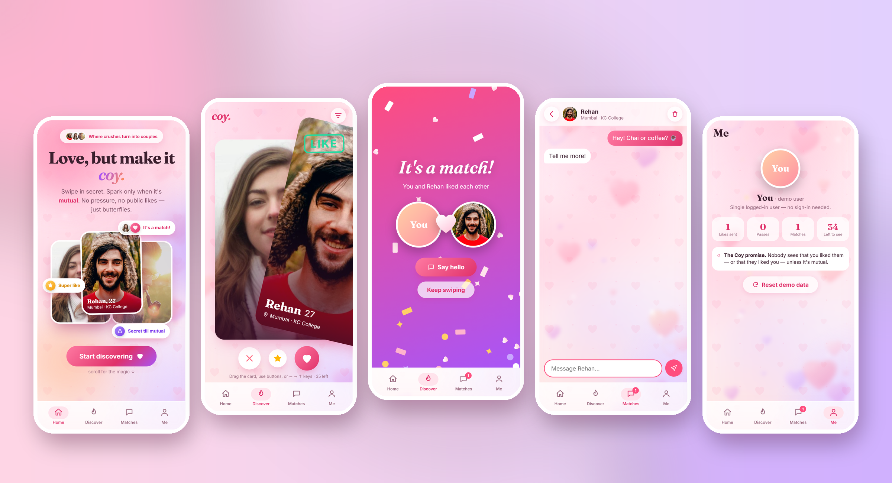
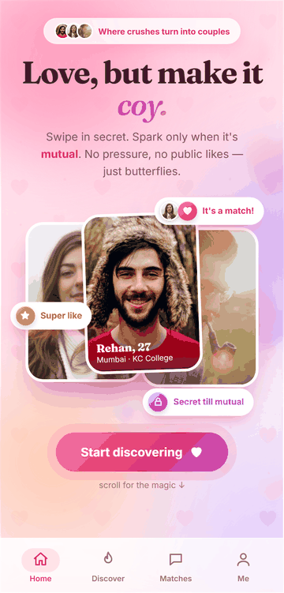
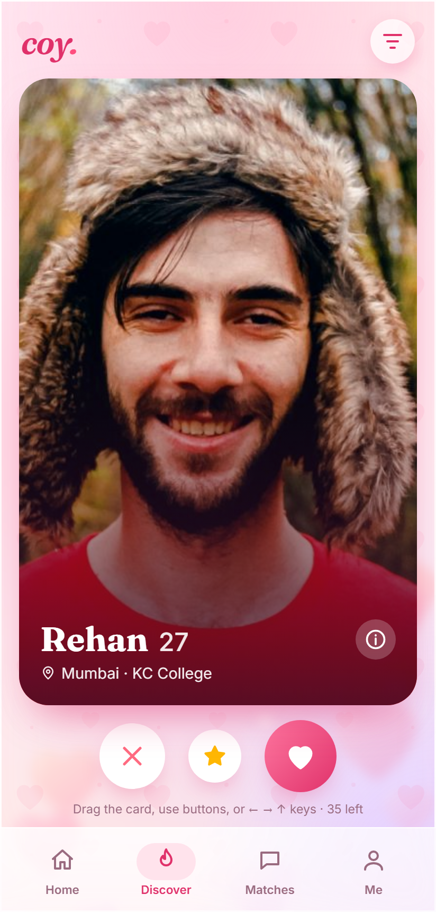
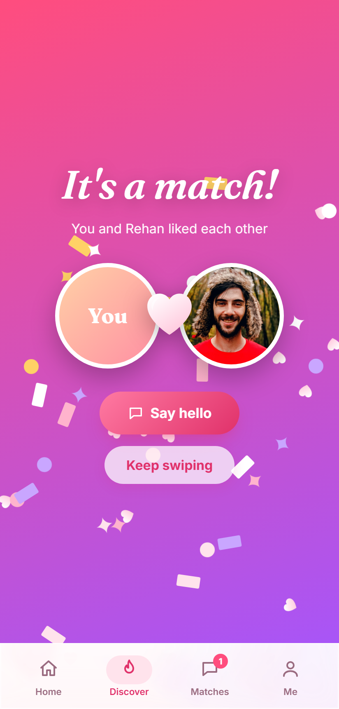
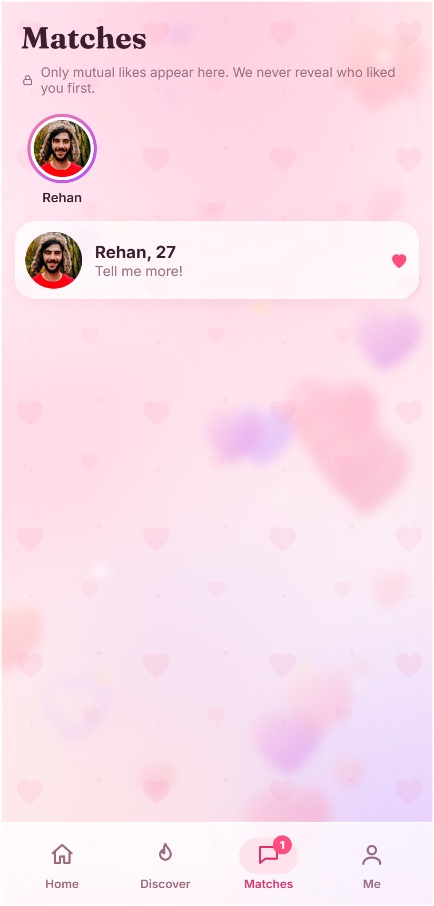
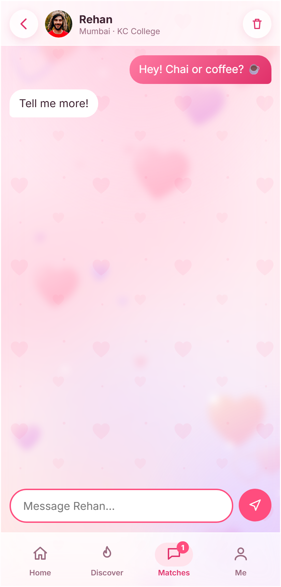
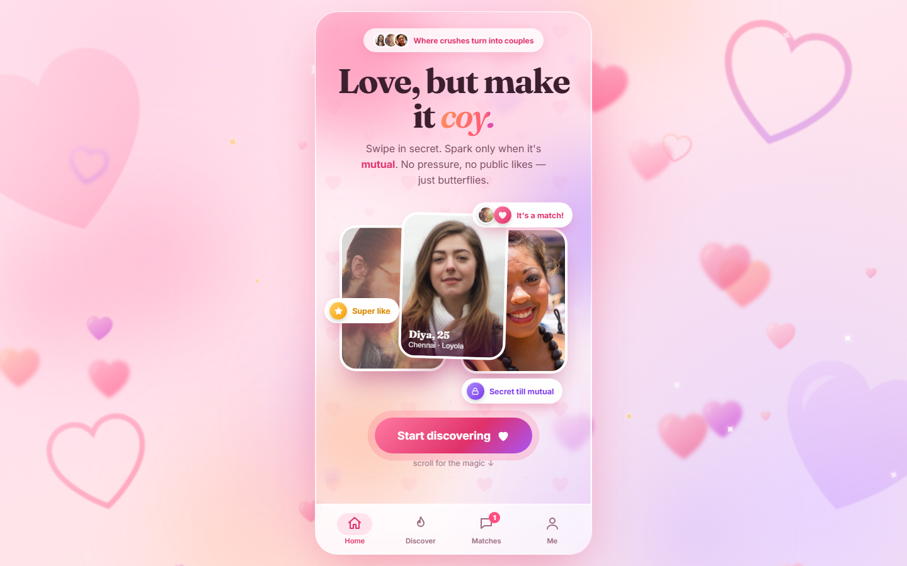
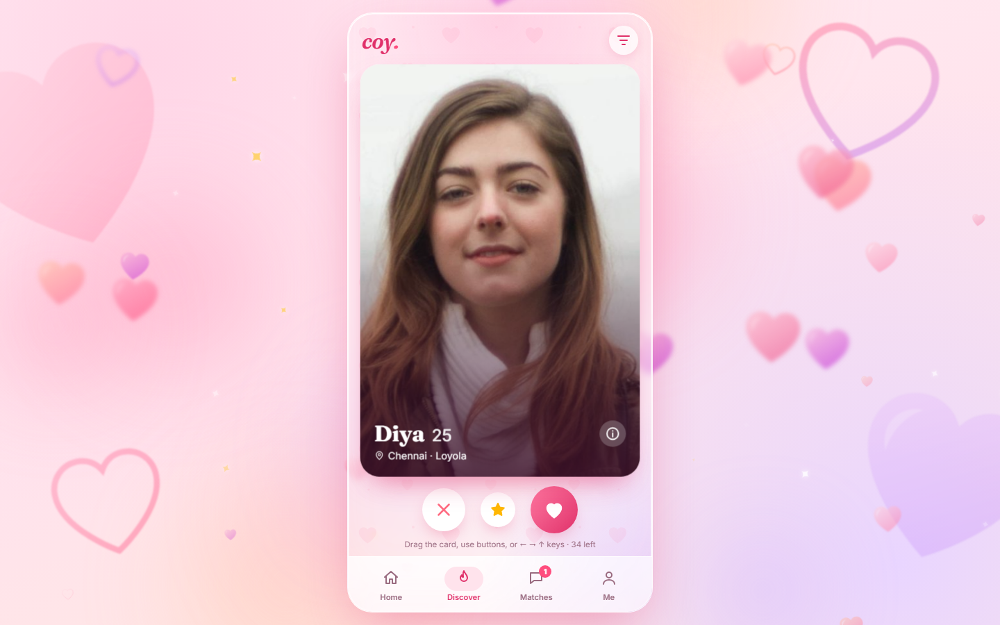
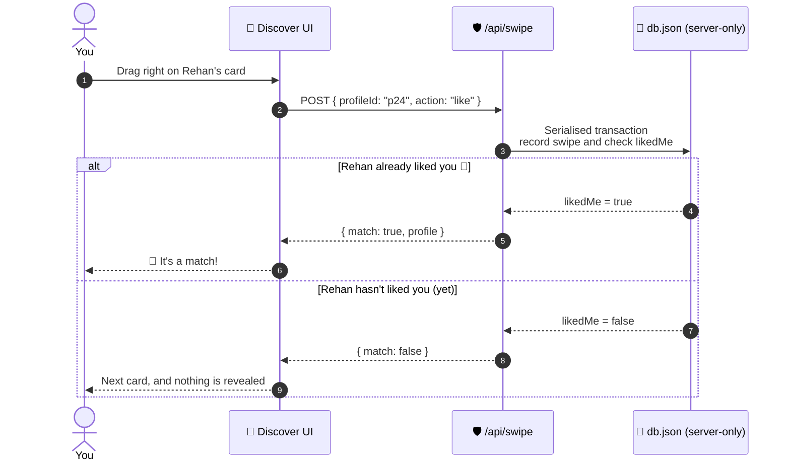
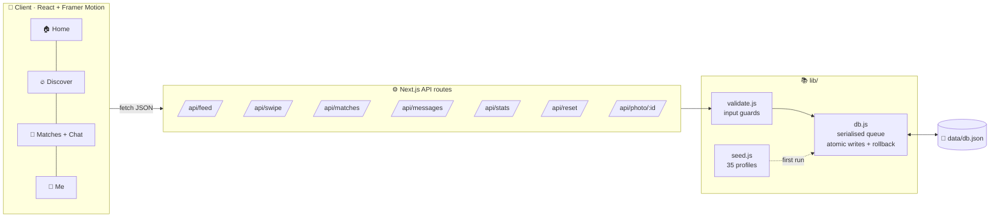

<div align="center">


<a href="#-quick-start">
  
</a>

<br/>


<h3>💗 A swipe-to-discover dating experience built around one promise:<br/><i>nobody learns who liked them unless it's mutual.</i></h3>



</div>

---

## 🎬 See it in action

<table>
<tr>
<td width="42%" align="center">

<br/><sub><b>Real capture</b> · recorded by Playwright from the running app</sub>
</td>
<td width="58%">

### What you're watching

1. 🏠 **Landing page.** Floating hearts, live stats and a "Start discovering" CTA.
2. 👆 **Drag to swipe.** The card tilts with your finger, and a **LIKE** / **NOPE** / **SUPER** stamp fades in as you pull.
3. 💞 **It's a match!** Confetti fires, both avatars kiss, and a heart pops between them.
4. 💬 **Say hello.** Chat opens with icebreakers, and the other side replies.
5. 👤 **Me.** Your own counters, the privacy promise, and a one-tap demo reset.

> **Try it yourself in 30 seconds:** `npm install && npm run dev`, then open **http://localhost:3000**.

</td>
</tr>
</table>

---

## ✨ Feature tour

<table>
<tr>
<td align="center" width="25%"><br/><b>Discover</b><br/><sub>One card at a time, spring physics</sub></td>
<td align="center" width="25%"><br/><b>Profile details</b><br/><sub>Tap ⓘ for bio and interests</sub></td>
<td align="center" width="25%"><br/><b>Matches</b><br/><sub>Only mutual likes ever land here</sub></td>
<td align="center" width="25%"><br/><b>Chat</b><br/><sub>Icebreakers, replies, unmatch</sub></td>
</tr>
</table>

| | Feature | Details |
|:-:|---|---|
| 👆 | **Gesture swiping** | Drag with touch or mouse, use the ✕ ⭐ ♥ buttons, or press **← → ↑** on desktop |
| 🏷️ | **Live stamps** | LIKE / NOPE / SUPER fade in proportionally to how far you drag |
| ⭐ | **Super like** | A first-class action that can also produce a match |
| 🎉 | **Match moment** | Full-screen confetti with a "Say hello" or "Keep swiping" choice |
| 🔁 | **No repeats, ever** | Swiped profiles are excluded server-side and survive reloads. Swipes are idempotent. |
| 🎛️ | **Filters** | Age range and city, validated on the server |
| 💬 | **Chat** | Allowed only with mutual matches (403 otherwise). Includes icebreakers and simulated replies. |
| 💔 | **Unmatch** | Removes the match and the chat, and the profile never comes back |
| 💾 | **Persistence** | Swipes, matches and messages are stored in `data/db.json`. **Me → Reset demo data** restores the seed. |
| 🖼️ | **Offline-safe photos** | Each photo has a local SVG portrait fallback (`/api/photo/[id]`) if the CDN is unreachable |
| 🌸 | **Lovey-dovey theme** | Blush, rose and lilac gradients, glass surfaces, Fraunces + Inter, floating hearts |

<details>
<summary><b>🖥️ Desktop view</b> (click to expand)</summary>
<br/>
<p align="center"> </p>
</details>

---

## 🔒 Privacy by design: the Coy promise

> **On Coy, a like is a secret until it becomes a match.**
> The app never reveals that you liked someone, or that someone liked you, unless the like is mutual.



| Guarantee | How it's enforced |
|---|---|
| 🙈 `likedMe` never reaches the browser | `publicProfile()` strips it on **every** route, and a regression test checks each response |
| 🎲 Feed order can't leak likers | Profiles are sorted by a stable FNV-1a hash, not by "liked you first" |
| 🚫 A pass never creates a match | Matching only happens when `action !== "pass" && likedMe` |
| 🤐 Chat requires a mutual match | `GET` and `POST /api/messages` return **403** for anyone you haven't matched |
| 🔁 Double-taps can't double-match | Swipes are idempotent and run inside a serialised write queue |

---

## 🏗️ Architecture



**Inside the data layer ([`lib/db.js`](lib/db.js)):**
- 🧵 **Serialised transactions.** All writes go through one promise queue, so there are no lost updates even with 35 parallel swipes.
- ↩️ **Rollback.** If a transaction throws, the in-memory state is restored from a `structuredClone` backup.
- ⚛️ **Atomic persistence.** Data is written to a temp file and then renamed over the real one, with a retry for Windows file locks.
- 🔄 **Hot reload of on-disk changes.** The store checks the file's mtime, so a reset from a test run is picked up immediately.

---

## 🚀 Quick start

```bash
git clone https://github.com/ash41106/coy_take_home_task.git
cd coy_take_home_task
npm install
npm run dev          # → http://localhost:3000
```

<details>
<summary><b>🪟 Windows one-click</b></summary>

| Command | What it does |
|---|---|
| `run.bat` | Dev mode, opens the browser |
| `run.bat prod` | Optimised production build and start |
| `run.bat test` | Builds, starts the server, runs every test, then stops it |

</details>

<details>
<summary><b>🏭 Production build</b></summary>

```bash
npm run build && npm start
```
</details>

Requires **Node 18+**. There are no databases, native modules or environment variables to set up. 9 of the 35 seeded profiles have already liked you, so you'll hit a match within a few swipes.

---

## 🔌 API reference

| Method | Route | Description |
|:-:|---|---|
|  | `/api/feed?minAge&maxAge&city` | Profiles you haven't swiped on (privacy-stripped, hash-ordered) |
|  | `/api/swipe` `{ profileId, action: like\|pass\|super }` | Records a swipe and returns `{ recorded, match, profile? }` |
|  | `/api/matches` | Your mutual matches |
|  | `/api/matches?id=` | Unmatch |
|   | `/api/messages` | Chat with a match (403 for anyone else) |
|  | `/api/stats` | Your own counters |
|  | `/api/photo/:id` | Local SVG portrait fallback |
|  | `/api/reset` | Restore the demo seed |

<details>
<summary><b>Example: a mutual like</b></summary>

```http
POST /api/swipe
Content-Type: application/json

{ "profileId": "p24", "action": "like" }
```
```json
{ "recorded": true, "match": true, "profile": { "id": "p24", "name": "Rehan", "age": 27, "place": "Mumbai · KC College", "interests": ["Photography", "Film", "Walks"] } }
```
A non-mutual like returns `{ "recorded": true, "match": false }` and nothing else.
</details>

---

## 🧪 Testing

```bash
npm test            # 34 API checks   (server must be running)
npm run test:e2e    # 7 Playwright browser tests (mobile viewport, auto-starts server)
```

| Suite | Covers |
|---|---|
| 🛡️ **API (34)** | Privacy regression on **every** route · ordering-leak check · input validation (400/404/403) · **35 parallel swipes** · duplicate-swipe races · messaging rules · persistence |
| 🎭 **E2E (7)** | Landing page CTA · button swipes · drag gesture · no-repeat across reload · match screen to Matches list · **chat send and reply with no client errors** · empty state · filters |

> 🐛 **Caught by this suite:** newer Chromium returns a Promise from `scrollIntoView()`. A one-line `useEffect` was implicitly returning it, so React treated it as a cleanup function and the chat crashed on the first message. The fix and a regression test are both in the repo.

---

## 📁 Project structure

```
coy/
├── app/
│   ├── api/            feed · swipe · matches · messages · stats · reset · photo/[id]
│   ├── components/     Home · Discover · SwipeCard · MatchScreen · Filters · Empty · Matches · Me · Backdrop · Art
│   ├── layout.js
│   └── page.js         Tab shell (Home · Discover · Matches · Me)
├── lib/
│   ├── db.js           Serialised-transaction JSON store
│   ├── seed.js         35 handcrafted profiles
│   └── validate.js     Tiny dependency-free validators
├── e2e/                Playwright specs
├── scripts/            api-test · screenshot · capture-docs (generates these README images)
├── docs/               Screenshots + demo GIF
└── run.bat             Windows one-click launcher
```

---

## 🗺️ Roadmap

- [x] Swipe deck with gestures, stamps, super like and keyboard controls
- [x] Mutual-only matching with the privacy guarantees above
- [x] Matches, chat, unmatch and filters
- [x] Concurrency-safe persistence and API plus E2E tests
- [ ] Real accounts and authentication (currently a single demo user)
- [ ] Postgres or SQLite storage for multi-instance deployments
- [ ] Rate limiting on swipes
- [ ] Undo last swipe
- [ ] Real-time chat over WebSockets

---

<div align="center">

### 💌 Built with butterflies for the **Coy** take-home task

<sub>Made with Next.js, Framer Motion and a slightly unreasonable amount of pink.</sub>


</div>
